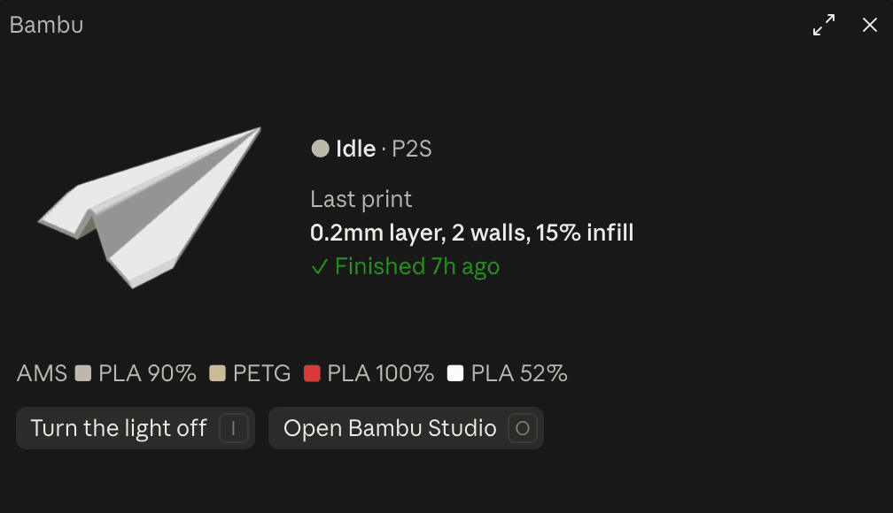
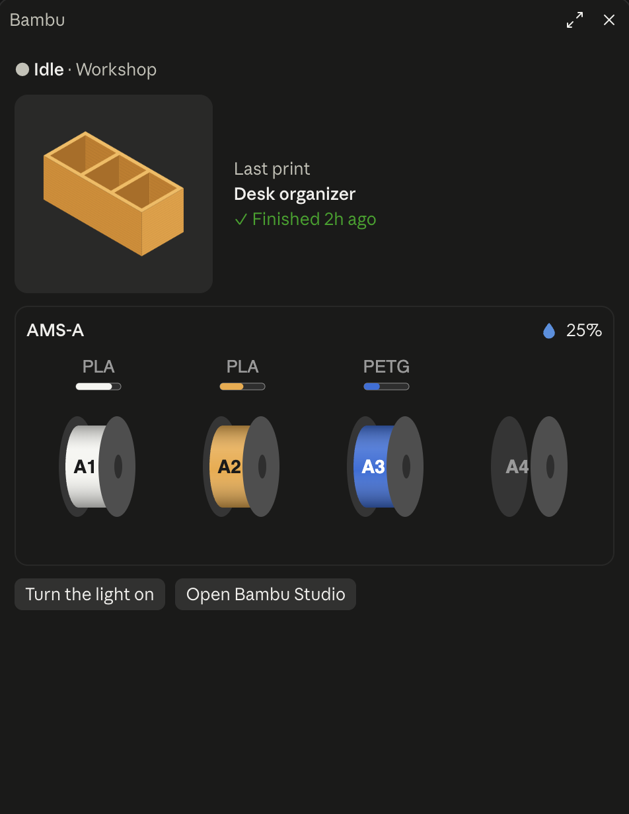
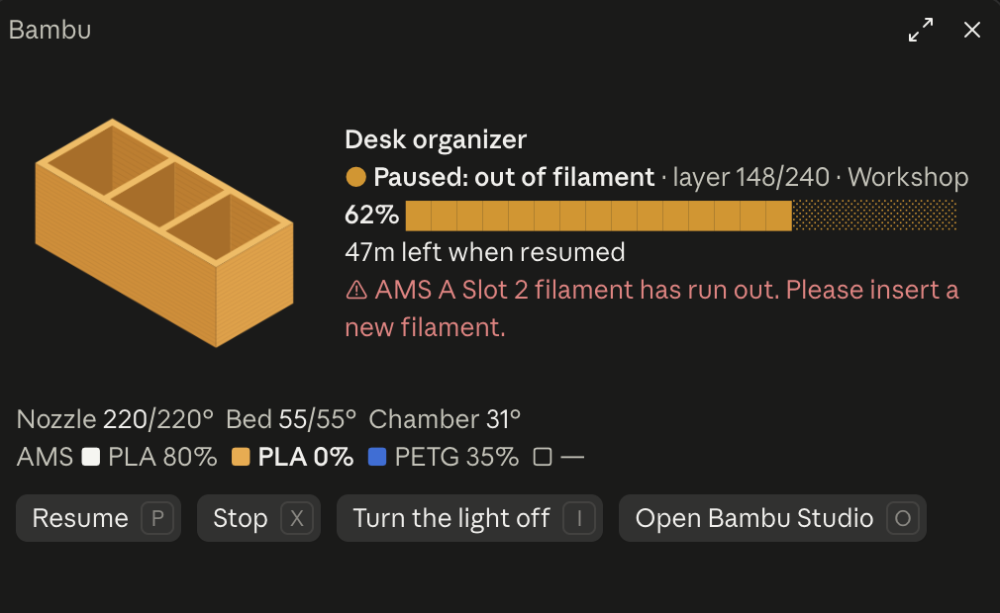

<div align="center">


# Bambu Lab printer pane for Claude Code

[](https://github.com/artemnovichkov/claude-code-bambu-lab/releases)
[](#install)
[](#requirements)
[](bridge/bridge.py)
[](LICENSE)

</div>

A [Claude Code](https://claude.com/claude-code) plugin that keeps your Bambu Lab printer in a pane beside the chat, in the desktop app and in the terminal: what it's printing, the stage, progress and layer, time left and when it'll be done, nozzle, bed and chamber temperatures, the AMS filaments with their colours, HMS errors, and the plate thumbnail. When the printer is idle, it shows the last print and how it ended.

Buttons in the pane turn the chamber light on and off, pause, resume or stop a print (each asks to confirm), and open Bambu Studio.

Status comes live from Bambu Lab's cloud, the same way Bambu Studio and Bambu Handy get it, so the printer can be anywhere with a connection.

<p align="center">
  
</p>

| Finished | Out of filament |
| --- | --- |
|  |  |

## Install

At the prompt of a Claude Code terminal session:

```
/plugin install bambu --marketplace artemnovichkov/claude-code-bambu-lab
```

Answer `y` to add the marketplace, then pick a scope (user scope shows the pane in every session). The pane opens in the next session you start.

### Requirements

- macOS: sign-in uses native dialogs and the Keychain, thumbnails use `sips`.
- `python3` (the one from the Xcode Command Line Tools is fine; no packages needed).
- A Bambu Lab account with the printer bound to it. LAN-only mode isn't supported.

## Sign in

Press **Sign in to Bambu Lab** in the pane, or type `/bambu sign-in`. macOS dialogs ask for your email, your password (in a hidden field) and, when Bambu asks for one, the code it emails you or the code from your authenticator app. Leave the password empty to sign in with an emailed code only.

The password goes to Bambu Lab only and is never stored. The tokens Bambu answers with are kept in your login Keychain under the service `claude-bambu`; `/bambu sign-out` deletes them.

## Settings

In `/plugin` → bambu → configure:

| Setting | What it does |
| --- | --- |
| `region` | `global`, or `china` for an account made on bambulab.cn. Sign in again after changing it. |
| `printer` | Which printer to show, by its name in Bambu Studio or the end of its serial number. Empty shows the first one. |
| `pane` | `auto` opens the pane when a session starts; `command` opens it only with `/bambu`. |

## Commands

- `/bambu`: open the pane
- `/bambu sign-in`, `/bambu sign-out`
- `/bambu refresh`: ask the printer for its full status and reload the printer list

## How it works

The plugin's hooks module draws the pane and starts `bridge/bridge.py`, a small Python program that signs in to Bambu Lab's cloud API, follows the printer's reports over MQTT (TLS, port 8883), and prints the printer's state as JSON lines for the pane. Buttons reach the bridge through command files in `~/Library/Application Support/claude-bambu/commands`. That folder also holds the bridge's state, cached thumbnails and `bridge.log`, which never contains tokens, passwords or serial numbers.

Each Claude Code session runs its own bridge, so several open sessions mean several connections to Bambu's broker.

## Known limits

- Bambu Lab's cloud API isn't public. The bridge introduces itself the way a slicer's network agent does, as other third-party Bambu tools do, and Bambu may change or close that access at any time.
- Pause, resume, stop and the light go through the cloud; how quickly the printer acts on them depends on Bambu's service.

## Development

Run the tests and checks from the repository's folder:

```
claude plugin test .
claude plugin validate .
```

`BAMBU_FIXTURE=<file.jsonl> python3 bridge/bridge.py` plays recorded MQTT messages, one JSON object per line, instead of signing in. A line `{"device": name}` names the printer; `{"tasks": [...]}` stands in for its cloud tasks, with `ago` (seconds since the task ended) and `cover` (a PNG beside the fixture).

`fixtures/` holds made-up prints for the screenshots: `printing.jsonl`, `paused.jsonl` and `idle.jsonl`. The bridge inherits the session's environment, so this shows one in the pane:

```
BAMBU_FIXTURE=$PWD/fixtures/printing.jsonl claude --plugin-dir .
```

### Releasing

1. Bump `version` in `.claude-plugin/plugin.json`: installed copies update only when it changes.
2. Add a `## <version> - <date>` section on top of [CHANGELOG.md](CHANGELOG.md).
3. Commit, then push the tag: `git tag v<version> && git push origin v<version>`.

The [Release workflow](.github/workflows/release.yml) checks the tag against `plugin.json` and publishes a GitHub release with that version's changelog section as its notes.

## More from me

- [3d-prints](https://github.com/artemnovichkov/3d-prints): models I design and print, with OpenSCAD and Fusion sources and ready-to-print 3MFs.
- [MakerWorld](https://makerworld.com/en/@artemnovichkov): the same models, published.

## Disclaimer

This is an independent project. It is not affiliated with, endorsed by or sponsored by Bambu Lab or Anthropic. Bambu Lab, Bambu Studio and Bambu Handy are trademarks of Bambu Lab; Claude and Claude Code are trademarks of Anthropic. They are named here only to say what the plugin works with.

## Author

Artem Novichkov, https://artemnovichkov.com/

## License

[MIT](LICENSE)
